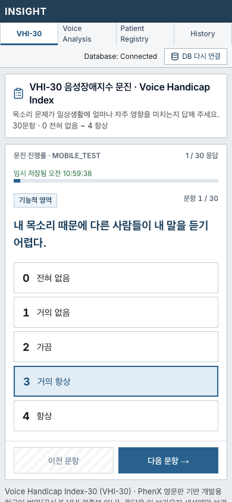

# INSIGHT

음성 기반 근위축성 측삭경화증(ALS) 조기 선별 보조 연구 프로토타입 · Early screening support for ALS through speech analysis

Next.js 16 / React 19 화면과 Python HuBERT 추론 서비스로 구성됩니다. 익명·시험 데이터 전용입니다. 출력은 **선별 보조 정보**이며 진단이 아닙니다.

| 무엇을 하나 | 어디서 확인하나 |
|---|---|
| VHI-30 자가보고 문진(모바일, DB 임시 저장·이어쓰기) + 음성 파일 AI 분석을 같은 가명 Subject ID로 결합 | `/questionnaire`, `/analysis`, `/patients` |
| 배포 가중치가 특정 학습 실행에서 나왔음을 **증명**(10개 검사, 오프라인 재현) | [`model_card.json`](model_card.json), [`provenance/`](provenance/), 결과 화면 "모델 근거" |
| 합성 음성으로 추론 결과 재현 | [`examples/`](examples/), `scripts/reproduce_inference.py` |
| Firebase 클라이언트 접근 전면 차단, 서버 전용 인증 | [`firebase.database.rules.json`](firebase.database.rules.json), [`docs/database-schema.md`](docs/database-schema.md) |

---

## 1. 배경 및 필요성

### 핵심 문제: 생각보다 많은 국민이 음성 장애를 겪고 있다

| 근거 | 확인된 내용 |
|---|---|
| Kim KH et al. *J Voice* 2016;30(2):246.e1-7 ([PMID 25985718](https://pubmed.ncbi.nlm.nih.gov/25985718/)) | 국민건강영양조사 2008–2011, 19세 이상 **19,636명**. 음성장애 유병률 **8.12%**(1,594명). 성인 약 12명 중 1명 |
| Roy N et al. *J Speech Lang Hear Res* 2004;47(2):281-93 ([PMID 15157130](https://pubmed.ncbi.nlm.nih.gov/15157130/)) | 무작위 표본 2,531명. 일반인(비교사) 현재 음성문제 **6.2%**, 평생 경험 **28.8%** |
| 건강보험심사평가원 [보건의료빅데이터개방시스템](https://opendata_visual.hira.or.kr/hbis/svcIntro.do) · [질병정보서비스 API](https://www.data.go.kr/data/15119055/openapi.do) · [R49 음성장애 통계](https://statnorth.kr/diseases/R49) | 2025년 음성장애(R49) 진료인원 **2.6만 명**, 2016년 대비 **+38%**. 최다 연령대 60–69세 |
| Cohen SM et al. *Laryngoscope* 2012;122(7):1589-94 ([PMID 22549455](https://pubmed.ncbi.nlm.nih.gov/22549455/)) | 후두질환 단기장애 청구자의 평균 결근 **39.2일**, 12개월 평균 임금손실 **$4,437.89** |

```text
성인 8.12%가 음성장애 (국내 대규모 조사)        ┐
평생 경험 28.8%, 진료인원은 9년간 +38% 증가      ├─► 음성 장애는 소수의 문제가 아님
결근·임금손실 등 생활 부담                       ┘
        │
        ▼
병원 방문 전에 스마트폰으로 쉽게 할 수 있는 음성 선별이 필요
        │
        ▼
INSIGHT: 녹음 파일 → AI 음성이상점수 + 음향 지표,  VHI-30 → 본인이 느끼는 불편 정도
```

수치는 음성장애 **전체**에 대한 것이며, R49 진료인원은 심평원 자료를 가공한 스탯노스 페이지에서 인용했습니다(2025.12.31 기준). ALS와의 연결은 학습 데이터(SAND Challenge Task 1의 ALS/HC 라벨)에 근거합니다.

### 왜 VHI-30과 AI 음성 분석을 함께 보나

| | VHI-30 | AI 음성이상점수 · 음향 지표 |
|---|---|---|
| 측정 대상 | 환자가 **인식하는** 음성 장애의 기능·신체·정서적 영향 | 녹음 신호에서 추출한 표현(HuBERT)과 F0·강도 변동 |
| 성격 | 주관적 자가보고, 0–120점 | 객관적 신호 기반, 0–1 점수 |
| 한계 | 본인이 변화를 인지해야 점수에 반영 | 녹음 조건·분포 이동에 민감, 임상 기준값 없음 |

두 값은 서로 다른 구성개념을 측정하므로 **합산하지 않고 나란히** 보여줍니다. "AI 점수는 높은데 VHI는 낮은 불일치가 본인이 인지하기 전의 변화를 시사할 수 있다"는 것은 **검증되지 않은 가설**입니다.

---

## 2. 시스템 구조

```text
[모바일/PC 브라우저]
  VHI-30 문진 (30문항, 0–4점)          음성 파일 선택 (WAV/FLAC/OGG; M4A·MP3는 브라우저에서 16 kHz WAV로 변환)
   │ 응답마다 임시 저장 (DB 연동 시)          │ XMLHttpRequest 업로드 진행률
   ▼                                          ▼
[Next.js 서버]                              /api/analyze ──► [FastAPI :8001] src/backend/app.py
  /api/database/questionnaire-drafts          decode → mono → 16 kHz → HuBERT-large(frozen) hidden_states[7]
  /api/database/questionnaires (점수 재계산)  → 시간축 max pooling(1024) → StandardScaler → MLP → sigmoid
  /api/model-card (가중치 SHA-256 대조)      + F0(YIN)·강도 CV·dBFS (모델과 독립)
   │ FIREBASE_DATABASE_SECRET (서버 전용, .env.local)
   ▼
[Firebase Realtime DB insight-95038]  subjects / recordings / analyses / acoustic_metrics / questionnaires / questionnaire_drafts
  클라이언트 읽기·쓰기 전면 거부 (401). 원본 음성은 저장하지 않음.
```

---

## 3. 모델 근거: 배포 가중치 ↔ 학습 실행 증명

배포된 `head.pt`는 학습 실행 **`20261005T055211_070474Z`**(Google Drive `HUBERT_PAPER_REPRODUCTION/`)의 `models/27074b1545/detection/MLP_max_h07/` 산출물입니다. 근거 파일은 [`provenance/run_20261005T055211_070474Z/`](provenance/run_20261005T055211_070474Z/)에 있고, 원본 Drive 파일 ID와 SHA-256은 `drive_sources.json`에 기록했습니다. `scripts/build_model_card.py`가 아래 검사를 모두 **오프라인으로 다시 계산**하며, 하나라도 실패하면 `model_card.json`을 만들지 않습니다.

| # | 검사 | 결과 |
|---|---|---|
| 1 | 배포 `head.pt`·`scaler.npz`·`history.csv`·`validation.json`·`test_confusion_counts.npy`가 실행 폴더 원본과 바이트 단위 동일 (SHA-256) | 통과 |
| 2 | `split_manifest.csv`에서 split hash를 재계산하면 `run_config.json`·`COMPLETED.json`의 값과 일치, 피험자 중복 0 | 통과 |
| 3 | `history.csv` 22 epoch = best epoch 2 + patience 20 (실행 설정: max_epochs 100, lr 1e-3) | 통과 |
| 4 | `validation.json`이 실행의 MLP/max/h07 검증 행과 일치하고, **h07은 MLP+max에서 검증 정확도로 선택된 층** | 통과 |
| 5 | 시험 예측 328개가 시험 분할과 정확히 일치하고, 혼동행렬과 시험 정확도 75.30%를 재현 | 통과 |
| 6 | 배포 `head.pt`+`scaler.npz`를 실행의 HuBERT 특징 캐시에 적용하면 저장된 시험 확률을 재현 (최대 차이 6×10⁻⁸, 4개 샘플: HC·ALS 각 정분류 1·오분류 1) | 통과 |

```sh
.venv/bin/python scripts/build_model_card.py --check   # → provenance verified; model_card.json is up to date
```

앱의 `/api/model-card`는 실행 중인 가중치 해시를 카드와 대조해 결과 화면에 "학습 실행 (증명됨)"으로 표시하고, 다르면 경고합니다. DB의 `analyses` 레코드에는 `model_card_sha256`이 저장되어 **저장된 점수 → 가중치 → 학습 실행**으로 추적됩니다.

| 항목 | 값 |
|---|---|
| 데이터 | SAND Task 1 training sheet. Class 5 = HC, 1–4 = ALS. 271명, 2,164개 녹음 |
| 분할 | **피험자 단위** 층화 70/15/15, seed 42. train 189 / val 41 / test 41명 (녹음 1,510 / 326 / 328) |
| 특징 | frozen `facebook/hubert-large-ls960-ft` @ `ece5fabb`, hidden_states[7], 시간축 max pooling |
| 학습 | Adam, lr 1e-3, batch 64, BCE, max 100 epoch, patience 20, 최소 val loss epoch 선택. Head: Linear(1024,128)–ReLU–Linear(128,1) |
| 검증 (선택용) | **73.31%** (239/326), best epoch 2 |
| 시험 (녹음 단위) | ACC **75.3%**, 민감도 **86.0%**, 특이도 **58.6%**, 균형정확도 72.3%, EER 0.234 |

**해석 범위.** 시험 수치는 선택에 쓰지 않은 41명에서 나왔지만 같은 SAND 분포·녹음 프로토콜 내부의 결과이며, 스마트폰 녹음 등 배포 앱 입력에서의 성능이 아닙니다. 피험자당 평균 약 8개 녹음이므로 녹음 단위 지표는 유효 표본 수를 과대평가합니다. 특이도가 낮아 0.5 기준에서 위양성이 많습니다. 저장소의 노트북(MAX_EPOCHS 20, PATIENCE 3, LR 5e-4)은 이후 설정을 바꾼 버전으로, 저장된 출력은 다른 실행(`20261005T080540_357849Z`)의 것입니다. 특징 추출·분할 코드는 같습니다.

---

## 4. 차별점과 기존 방법 대비

**모델 측면 — 같은 실행, 같은 분할에서 pooling만 바꾼 비교** (각 조합은 검증 정확도로 층 선택, 시험은 선택에 미사용; `provenance/.../test_all_layers.csv`)

| Head | Pooling | 선택 층 | 시험 ACC | 민감도 | 특이도 | EER |
|---|---|---|---:|---:|---:|---:|
| MLP | mean | h00 | 66.2% | 75.5% | 51.6% | 0.345 |
| MLP | mean+std | h00 | 70.4% | 77.5% | 59.4% | 0.305 |
| MLP | **max (배포)** | **h07** | **75.3%** | **86.0%** | 58.6% | **0.234** |
| CNN | mean | h03 | 69.5% | 87.0% | 42.2% | 0.315 |
| CNN | mean+std | h07 | 73.8% | 79.0% | 65.6% | 0.285 |
| CNN | max | h05 | 78.4% | 79.0% | 77.3% | 0.225 |

두 head 모두에서 max pooling이 전역 평균(mean)보다 높았습니다. 국소적 발성 이상이 평균에서 희석될 수 있다는 가설과 일치하는 관찰이지만, 단일 seed·녹음 단위·한 데이터셋 결과이므로 일반화된 결론은 아닙니다.

**시스템 측면**

| 일반적인 데모 | INSIGHT |
|---|---|
| 모델 정확도를 README에 숫자로만 기재 | 배포 가중치가 어느 학습 실행에서 나왔는지 바이트 해시·확률 재현으로 증명, 런타임에 재검증 |
| 측정하지 못한 지표를 기본값으로 표시 | Jitter·Shimmer·HNR·중증도 등급은 근거가 없어 `null`/미분류로 표시 |
| 설문 점수를 클라이언트 값 그대로 저장 | 서버가 원 응답에서 VHI 점수를 재계산 |
| 설문 중간에 나가면 처음부터 | DB 임시 저장, 같은 Subject ID로 이어서 작성 |
| 공개 DB 규칙 | 클라이언트 접근 전면 차단, 서버만 접근 |
| 재현 수단 없음 | 결정론적 합성 음성 + 기대 출력 비교 스크립트 |

---

## 5. 빌드·추론 성능 (직접 실행, 2026-11-26)

환경: Intel Core i5-8279U 2.4 GHz, 16 GB, macOS, CPU 추론, Python 3.11.15, torch 2.2.2.

| 항목 | 결과 |
|---|---|
| `npm run lint` / `typecheck` | 통과 |
| `npm test` | **18/18 통과** (VHI 점수·문항 매핑, 임시 저장 검증, Firebase 인증·권한 거부, 모델 카드 증명 검사 등) |
| `npm run build` | 성공, **24.9 s** |
| HuBERT + head 로드 | 4.2–8.5 s (캐시 상태에 따라) |
| E2E `/api/analyze` (3 s 녹음) | 첫 요청 **8.8 s**(모델 로드 포함), 이후 **1.0–1.4 s** |
| 추론 시간 vs 녹음 길이 | 3 s → 0.97 s · 10 s → 3.1 s · 30 s → 13.3 s · 60 s → 41.3 s (중앙값, 3회) |
| 최대 메모리 (60 s 추론 포함) | 약 3.1 GB RSS |
| 실제 DB E2E | 연결 → 분석 결과 업로드 → 문진 임시 저장·복원 → 제출 시 임시본 삭제 → 재조회 전 단계 통과 (검증 레코드는 이후 삭제) |
| 모바일 (Comet, 390×844) | 가로 스크롤 없음. 임시 저장 → 새 세션에서 복원 → 30문항 완료까지 확인 |

추론 시간은 녹음 길이에 대해 초선형으로 증가합니다(Transformer self-attention). 짧은 과제 녹음(모음 연장 3–10 s)을 권장합니다. 동시 요청 처리량은 측정하지 않았습니다.

| 문항 화면 | 결과 화면 |
|---|---|
|  |  |

### 합성 음성 재현 예시

```sh
.venv/bin/python scripts/synthetic_voice.py          # examples/*.wav 재생성 (결정론적, SHA-256 동일)
.venv/bin/python scripts/reproduce_inference.py      # 기대 출력과 비교 → PASS / FAIL
```

| 파일 | 설계 | 모델 점수 | F0 SD | Intensity CV |
|---|---|---:|---:|---:|
| `synthetic_vowel_a_steady.wav` | F0 120 Hz 고정, 진폭 일정 | 0.999982 | 0.00 Hz | 0.074 |
| `synthetic_vowel_a_unstable.wav` | 주기별 F0 섭동 3%, 5 Hz 진폭 떨림, 잡음 | 0.999988 | 1.37 Hz | 0.105 |

음향 지표는 설계대로 두 신호를 구분합니다. 이 예시는 파이프라인의 **결정성·재현성** 검증용입니다. 합성 신호는 학습 분포 밖이라 모델 점수는 둘 다 약 1.0으로 포화되며, 분포 밖 입력 처리는 향후 과제입니다.

---

## 6. 실행

```sh
python3.11 -m pip install -r requirements-inference.txt
npm install
cp .env.example .env.local     # FIREBASE_DATABASE_URL, FIREBASE_DATABASE_SECRET 입력 (DB 기능 사용 시)

HF_HOME=./hf-cache python3.11 -m uvicorn src.backend.app:app --host 127.0.0.1 --port 8001   # 터미널 1
npm run dev                                                                                  # 터미널 2 (또는 npm run build && npm start)
```

HuBERT 체크포인트·패키지·빌드 파일에 2 GB 이상의 여유 공간이 필요합니다. 검증 명령: `npm run lint`, `npm run typecheck`, `npm test`, `npm run build`, `python scripts/build_model_card.py --check`, `python scripts/reproduce_inference.py`.

| 경로 | 내용 |
|---|---|
| `/questionnaire` | VHI-30 문진. 모바일에서 한 화면에 한 문항, 진행률, 이전/다음, 미응답 안내. DB 연동 시 응답마다 임시 저장, 같은 ID로 재시작하면 이어서 작성. PC에서는 숫자키 0–4 |
| `/analysis` (`/`) | Subject ID·과제·녹음 시각 입력 후 **기존 오디오 파일 업로드**(앱 내 녹음 없음) |
| `/patients` | Subject ID별 녹음 결과와 최신 VHI-30 결과. DB 불러오기 |
| `/history` | 전체 분석 이력 |

**모바일 (PWA).** 760 px 이하에서 탭이 화면 폭에 맞춰지고 VHI 응답 버튼은 52 px 이상 세로 목록으로 바뀝니다. 홈 화면 설치 가능(Android Chrome: 앱 설치, iOS Safari: 공유 → 홈 화면에 추가). 서비스 워커·오프라인 캐시가 없어 기기에는 아무것도 저장되지 않습니다. 휴대폰 접속은 HTTPS가 필요합니다: `npm run build && npm start` 후 `cloudflared tunnel --url http://127.0.0.1:3000`. 터널 URL은 공개되며 Next.js API 경로에는 아직 사용자 인증이 없으므로 시험 데이터만 사용하세요.

---

## 7. Realtime Database와 보안

- 프로젝트 `insight-95038`(asia-southeast1). 구조와 필드: [`docs/database-schema.md`](docs/database-schema.md).
- [`firebase.database.rules.json`](firebase.database.rules.json)을 REST로 적용했습니다. 모든 클라이언트 읽기·쓰기가 거부됩니다(비인증 요청 401 확인).
- Next.js 서버만 `.env.local`의 `FIREBASE_DATABASE_SECRET`으로 접근합니다(`.gitignore` 처리, 커밋 안 됨). 서비스 계정(`FIREBASE_SERVICE_ACCOUNT_PATH`)도 지원합니다. 자격 증명이 없으면 공개 접근으로 대체하지 않고 거부합니다. Database Secret은 Firebase에서 레거시 방식이므로 운영 단계에서는 서비스 계정으로 바꾸는 것을 권장합니다.
- 관리자 자격 증명은 규칙의 `.validate`를 우회하므로 필드 검증은 서버 코드가 담당합니다. 필수 음향 값이 없으면 업로드를 막고 값을 만들어 넣지 않습니다. 원본 음성은 저장하지 않습니다.
- 남은 위험: 앱 사용자 로그인·권한 분리·감사 로그가 없고, 목록 조회는 전체 컬렉션을 읽습니다. **실제 환자 데이터에는 사용하지 마세요.**

---

## 8. 모델·지표 구현 세부

`head.pt`가 분류기 구조의 기준입니다: `Linear(1024,128)`, `ReLU`, `Linear(128,1)`. 고정 체크포인트의 legacy positional convolution 텐서는 로드 전에 현재 Transformers 키로 매핑해 학습된 값을 유지합니다. 검증된 3단계 임상 기준값이 없어 `src/backend/interpretation.py`의 상태는 `null`(미분류)입니다. 녹음 길이, RMS dBFS, full-scale 근접 샘플 비율은 측정하지만 품질 등급은 추론하지 않습니다.

VHI-30 문항은 PhenX 영문판(PX201301; Jacobson et al., 1997) 기반 **개발용 한국어 번역**이며 공식 K-VHI 검증본이 아닙니다. 원문 번호와 기능(F)·신체(P)·정서(E) 영역을 유지합니다. 한국어판 기준값이 검증되지 않아 총점과 영역별 점수만 표시합니다.

---

## 9. 기여 내역 (커밋 연결)

저장소 작성자(git author: 김성민)의 커밋입니다. 2026-11-16 이후 커밋은 Claude Code의 코드 작성 보조를 받았으며 커밋 메시지에 `Co-Authored-By`로 표기했습니다.

| 기능 / 차별점 | 커밋 |
|---|---|
| 초기 구현: Next.js 화면, FastAPI HuBERT 추론, 음향 지표, Firebase 업로드, PWA | [`ce9d62b`](https://github.com/KYU-SW/INSIGHT/commit/ce9d62b) |
| 결과 화면 위계·Registry 검색·접근성 개선 | [`2f9292d`](https://github.com/KYU-SW/INSIGHT/commit/2f9292d) |
| VHI-30 모바일 문진, 서버 점수 재계산, Subject ID 기반 음성 결과 결합 | [`42a1294`](https://github.com/KYU-SW/INSIGHT/commit/42a1294) |
| Firebase 클라이언트 접근 차단, 서버 전용 인증 | [`c8a46aa`](https://github.com/KYU-SW/INSIGHT/commit/c8a46aa) |
| 모델 카드와 런타임 가중치 해시 검증 | [`fe11bbe`](https://github.com/KYU-SW/INSIGHT/commit/fe11bbe) |
| 합성 음성 재현 예시와 기대 출력 비교 | [`f71d9ac`](https://github.com/KYU-SW/INSIGHT/commit/f71d9ac) |
| 배포 가중치 ↔ 학습 실행 `20261005T055211_070474Z` 증명 (10개 검사) | [`35b7c72`](https://github.com/KYU-SW/INSIGHT/commit/35b7c72) |
| 실제 Firebase DB 연결·규칙 적용, VHI-30 임시 저장·이어쓰기, 모바일 검증 | [`0684d26`](https://github.com/KYU-SW/INSIGHT/commit/0684d26) |

---

## 참고문헌

1. Kim KH, Kim RB, Hwang DU, Won SJ, Woo SH. Prevalence of and Sociodemographic Factors Related to Voice Disorders in South Korea. *J Voice*. 2016;30(2):246.e1-7. doi:10.1016/j.jvoice.2015.04.010
2. Roy N, Merrill RM, Thibeault S, Parsa RA, Gray SD, Smith EM. Prevalence of voice disorders in teachers and the general population. *J Speech Lang Hear Res*. 2004;47(2):281-93. doi:10.1044/1092-4388(2004/023)
3. Cohen SM, Kim J, Roy N, Asche C, Courey M. The impact of laryngeal disorders on work-related dysfunction. *Laryngoscope*. 2012;122(7):1589-94. doi:10.1002/lary.23197
4. Jacobson BH, Johnson A, Grywalski C, et al. The Voice Handicap Index (VHI): Development and Validation. *Am J Speech Lang Pathol*. 1997;6(3):66-70.
5. 건강보험심사평가원. 보건의료빅데이터개방시스템; 질병정보서비스 Open API (data.go.kr 15119055).
6. 스탯노스. 음성장애(R49) 환자 수·진료비 통계 (심평원 자료 가공, 2025.12.31 기준, 2026-11-26 확인).
