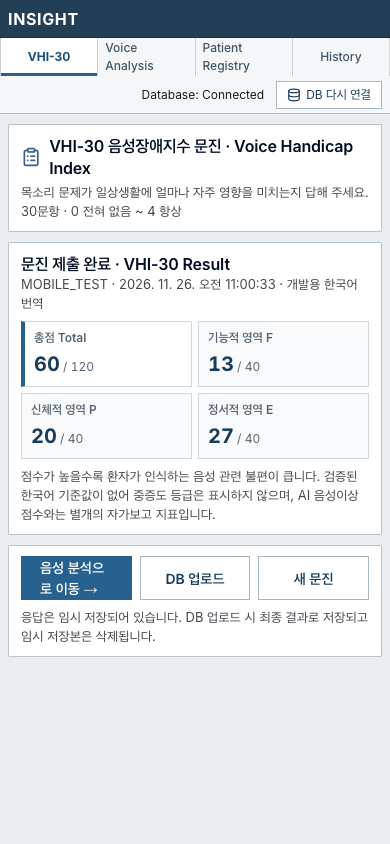

# INSIGHT

[](https://github.com/KYU-SW/INSIGHT/actions/workflows/ci.yml)

음성 기반 근위축성 측삭경화증(ALS) 조기 선별 보조 연구 프로토타입 · Early screening support for ALS through speech analysis

진료 전에 스마트폰 녹음 파일과 VHI-30 자가보고 문진을 받아, ALS 관련 음성 이상 점수·음향 지표·문진 점수를 의료진 기록으로 전달하는 시스템이다. Next.js 16 / React 19 화면, Python HuBERT 추론 서비스, Firebase Realtime Database로 구성된다. 익명·시험 데이터 전용이며, 출력은 **의뢰 우선순위 판단을 돕는 선별 보조 정보**이고 진단이 아니다.

| 핵심 결과 | 근거 |
|---|---|
| 시험 41명(피험자 단위) AUROC **0.898** [0.783–0.980], 민감도 92.0%, 특이도 75.0% | §3, `model_card.json` |
| **구음장애가 없는 ALS(SAND Class 4) 10명 중 8명** 검출 | §3 |
| 배포 가중치가 특정 학습 실행에서 나왔음을 11개 검사로 증명 | §3, [`provenance/`](provenance/) |
| 같은 분할에서 9개 모델 구성 × 3 seed 비교: 더 복잡한 구성이 기준 모델보다 유의하게 낫지 않음 | §4 |
| VHI-30 모바일 문진(임시 저장·이어쓰기) + 음성 분석을 같은 가명 ID로 결합해 DB에 저장 | §2, §6 |

근거별 원문과 확인 방법은 [`docs/evidence-traceability.md`](docs/evidence-traceability.md)에 정리했다.

---

## 1. 배경 및 필요성

### 1.1 임상 문제: ALS는 확진까지 약 1년이 걸린다

- 증상 발현부터 확진까지 중앙값 **11.5개월**이며, 환자의 **52%**가 다른 진단을 먼저 받고 평균 **3명**의 의사를 거친다(304명) [R1].
- 21개 연구를 종합하면 통상 **10–16개월** [R2], 4개국 1,405명 코호트에서도 중앙값 **11개월**이다 [R3].
- 지연의 주원인은 질환이 드물고 증상이 이질적이어서 1차 진료에서 ALS를 떠올리기 어렵다는 점이다. 상용 바이오마커가 없으므로 ALS 가능성이 높은 환자를 골라 전문의에게 빨리 보내는 **선별·분류(triage) 도구**가 필요하다고 제시된다 [R4, R3].
- 국내 발생률은 10만 명당 연 **1.20명**, 유병률 **3.43명**(2015), 진단 시 평균 61.4세, 평균 생존 **50.0개월**이다 [R5]. 생존 기간이 짧아 1년의 진단 지연은 치료·다학제 진료·임상시험 참여 기회를 크게 줄인다 [R4].

### 1.2 현행 평가·사전문진의 한계

- 연수(bulbar) 기능 평가 도구는 많지만 각각 상당한 한계가 있다 [R6]. 기존 임상 도구는 **초기 변화에 민감하지 않다** [R8].
- 표준 기능평가 척도 ALSFRS-R은 주관적 평정 기반이라 미세한 변화를 놓칠 수 있다. 실제로 일부 음성 지표는 **ALSFRS-R 발화 점수가 변하지 않은 기간에도** 연수 기능 저하를 추적했다(278명) [R9].
- 조사한 상용 사전문진 시스템(Epic MyChart, Phreesia)은 문진·선별검사를 EHR로 보내지만, 공개 문서에서 **음성 신호 수집·분석 기능은 확인되지 않았다**(§5) [S1–S3]. 자가보고는 환자가 변화를 인지해야만 반영된다.

### 1.3 음성 기반 선별의 근거

- 연수 기능 저하는 ALS의 특징적 소견이며 생존과 삶의 질에 직접 영향을 준다 [R6]. 음성 저하는 연수 침범의 **가장 이른 증상 중 하나**다 [R7].
- 원격으로 자주 수집한 음성을 자동 분석하면 초기 음성 변화를 검출·추적할 수 있다(65명, 3–9개월) [R8].
- 발병 초기에 '어눌한 말'이 있던 환자는 진단까지 걸린 시간이 더 짧았다(p = 0.02) [R1]. 음성 변화가 인지되면 진단이 빨라진다는 관찰이며, 음성 변화를 더 일찍 객관적으로 포착하려는 동기가 된다.

### 1.4 문진과 음향 분석을 함께 쓰는 이유

| | VHI-30 자가보고 | AI 음성 점수 · 음향 지표 |
|---|---|---|
| 측정 대상 | 환자가 **인식하는** 음성 장애의 기능·신체·정서적 영향 [R12] | 녹음 신호의 표현(HuBERT)과 F0·강도 변동 |
| 장점 | 진료 맥락(생활 불편)을 구조화해 전달 | 본인이 인지하지 못한 변화도 반영 가능 [R9] |
| 한계 | 인지된 변화만 반영, ALS에서 검증된 도구가 아님 | 녹음 조건·분포 이동에 민감, 임상 기준값 없음 |

두 값은 서로 다른 구성개념이므로 **합산하지 않고 나란히** 보여준다. "AI 점수는 높고 VHI는 낮은 불일치가 인지 이전의 변화를 시사한다"는 것은 **검증되지 않은 가설**이다.

### 1.5 INSIGHT가 다루는 문제와 위치

| 단계 | 정의 | INSIGHT |
|---|---|---|
| 조기 선별 | 증상이 모호한 사람 중 추가 평가가 필요한 사람을 표시 | **해당** (연구 프로토타입) |
| 위험 평가 | 개인의 질환 확률을 보정된 값으로 제시 | 해당 안 됨 — 점수 보정·임상 기준점 미검증 |
| 진단 보조 | 의사의 감별진단에 근거 제공 | 해당 안 됨 — 임상 검증 없음 |
| 확정 진단 | El Escorial/Gold Coast 기준, 근전도 등 | 해당 안 됨 |

**적용 집단에 대한 제약.** 음성 증상은 성인의 8.12%가 겪을 만큼 흔하지만 [R10] ALS는 드물다 [R5]. 시험 성능(민감도 92%, 특이도 75%)을 그대로 가정하면 양성예측도(PPV)는 일반 인구(유병률 3.43/10만)에서 **0.013%**, 사전확률 5%인 의뢰 집단에서 16%, 20%에서 48%다. 따라서 INSIGHT는 **일반인 대상 선별이 아니라, 음성·연수 증상으로 내원한 환자 중 신경과 의뢰 우선순위를 정하는 용도**로 설계했다. (PPV는 시험 성능을 외삽한 계산이며 측정값이 아니다.)

### 1.6 기대 가치

진료 전 단계에서 음성과 문진을 함께 구조화해 기록으로 넘기면, 음성 변화가 있는 환자를 더 일찍 신경과 평가로 연결하는 데 쓸 수 있다. 정량적 기대효과는 §7에서 **실험으로 입증된 것 / 근거 기반 추정 / 미검증**으로 구분했다.

---

## 2. 시스템 구조

```text
[모바일/PC 브라우저]
  VHI-30 문진 (30문항, 0–4점)          음성 파일 선택 (WAV/FLAC/OGG; M4A·MP3는 브라우저에서 16 kHz WAV로 변환)
   │ 응답마다 임시 저장 (DB 연동 시)          │ XMLHttpRequest 업로드 진행률
   ▼                                          ▼
[Next.js 서버]                              /api/analyze ──► [FastAPI :8001] src/backend/app.py
  /api/database/questionnaire-drafts          decode → mono → (>8 kHz면 8 kHz로) → 16 kHz → HuBERT-large(frozen) hidden_states[7]
  /api/database/questionnaires (점수 재계산)  → 시간축 max pooling(1024) → StandardScaler → MLP → sigmoid
  /api/model-card (가중치 SHA-256 대조)      → 특징 공간 OOD 거리 검사 (분포 밖이면 상태 해석 차단)
   │ 서버 전용 자격 증명 (.env.local)        + F0(YIN)·강도 CV·dBFS, 지속 모음은 Jitter·Shimmer·HNR(Praat) (모델과 독립)
   │ Next.js → FastAPI: Authorization: Bearer (서버 전용 토큰, 미설정 시 503)
   ▼
[Firebase Realtime DB]  subjects / recordings / analyses / acoustic_metrics / questionnaires / questionnaire_drafts
  클라이언트 읽기·쓰기 전면 거부 (401). 원본 음성은 저장하지 않음.
```

---

## 3. 배포 모델의 근거

### 3.1 배포 가중치 ↔ 학습 실행 증명

배포된 `head.pt`는 학습 실행 **`20261005T055211_070474Z`**의 `models/27074b1545/detection/MLP_max_h07/` 산출물이다. 근거 파일은 [`provenance/run_20261005T055211_070474Z/`](provenance/run_20261005T055211_070474Z/)에 있고, 원본 Drive 파일 ID와 SHA-256은 `drive_sources.json`에 있다. `scripts/build_model_card.py`가 아래 검사를 오프라인으로 다시 계산하며, 하나라도 실패하면 `model_card.json`을 만들지 않는다.

| # | 검사 | 결과 |
|---|---|---|
| 1 | 배포 `head.pt`·`scaler.npz`·`history.csv`·`validation.json`·`test_confusion_counts.npy`가 실행 폴더 원본과 바이트 단위 동일 | 통과 |
| 2 | `split_manifest.csv`로 split hash 재계산 = 실행 기록값, 피험자 중복 0 | 통과 |
| 3 | `history.csv` 22 epoch = best epoch 2 + patience 20 (실행 설정 max_epochs 100, lr 1e-3) | 통과 |
| 4 | `validation.json` = 실행의 MLP/max/h07 검증 행, h07은 MLP+max에서 검증 정확도로 선택된 층 | 통과 |
| 5 | 시험 예측 328개가 시험 분할과 정확히 일치하고 혼동행렬·시험 정확도 75.30% 재현 | 통과 |
| 6 | 배포 가중치를 실행의 HuBERT 특징 캐시에 적용하면 저장된 시험 확률 재현 (최대 차이 6×10⁻⁸) | 통과 |
| 7 | §4 비교 실행(`20261114T140021_240247Z_LOW_COST`)과 피험자→분할 매핑 동일 | 통과 |

앱의 `/api/model-card`는 실행 중인 가중치 해시를 카드와 대조해 결과 화면에 표시하고, 다르면 경고한다. DB `analyses` 레코드의 `model_card_sha256`으로 **저장된 점수 → 가중치 → 학습 실행**이 추적된다.

### 3.2 성능 (같은 분포 내부 시험)

| 항목 | 값 |
|---|---|
| 데이터 | SAND Task 1 training sheet [R11]: 이탈리아어 화자, 스마트폰 앱 녹음, 8 kHz. Class 5 = 건강군, 1–4 = ALS. 271명, 2,164개 녹음(모음 5개 + /pa/·/ta/·/ka/) |
| 분할 | **피험자 단위** 층화 70/15/15, seed 42. train 189 / val 41 / test 41명 (녹음 1,510 / 326 / 328) |
| 특징·분류기 | frozen `facebook/hubert-large-ls960-ft` @ `ece5fabb`, hidden_states[7], 시간축 max pooling → Linear(1024,128)–ReLU–Linear(128,1) |
| 학습 | Adam, lr 1e-3, batch 64, BCE, max 100 epoch, patience 20, 최소 val loss epoch |
| 시험 · 피험자 단위 (41명: HC 16, ALS 25) | **AUROC 0.898** [0.783–0.980], 정확도 85.4% [73.2–95.1], 민감도 **92.0%** [80.0–100], 특이도 **75.0%** [50.0–93.8] |
| 시험 · 녹음 단위 (328개) | 정확도 75.3% [68.3–81.4], 민감도 86.0% [77.5–93.0], 특이도 58.6% [46.9–69.5] |

[ ]는 95% 신뢰구간이다. 같은 사람의 녹음은 독립이 아니므로 **피험자를 재표본**했다(클래스 층화 cluster bootstrap 10,000회). 피험자 판정 규칙(피험자별 P(ALS) 평균 ≥ 0.5)은 평가 전에 고정했다.

**중증도별 민감도 (SAND Class, 피험자 단위)**

| SAND Class | 정의 [R11] | 시험 ALS | 검출 |
|---|---|---:|---:|
| 1 | 중증 구음장애 | 1 | 1 |
| 2 | 중등도 구음장애 | 5 | 5 |
| 3 | 경도 구음장애 | 9 | 9 |
| **4** | **구음장애 없음** | **10** | **8 (80%)** |

구음장애로 평정되지 않은 ALS 환자에서도 10명 중 8명을 검출했다. 조기 선별 가능성을 지지하는 관찰이지만 n = 10이라 불확실성이 크다.

**해석 범위.** 같은 SAND 분포·녹음 프로토콜 내부의 결과이며, 다른 언어·마이크·인구 집단에서의 성능이 아니다. HC가 16명뿐이라 특이도 구간이 넓다. 학습 음성은 모두 8 kHz이므로 `decode_audio`는 8 kHz를 넘는 입력을 학습과 같은 대역으로 낮춘다(8 kHz 입력은 학습 경로와 비트 단위 동일, 자동 테스트로 확인). 스마트폰 고음질 녹음에서의 실제 성능 변화는 측정하지 못했다.

---

## 4. 모델 선택 근거: 같은 분할에서의 비교 실험

배포 모델과 **같은 피험자 분할**(§3.1 검사 7)에서 수행한 비교 실험 `HUBERT_ALS_7EXP_HPO/20261114T140021_240247Z_LOW_COST`의 원본 결과다([`provenance/run_20261114T140021_240247Z_LOW_COST/`](provenance/run_20261114T140021_240247Z_LOW_COST/)). 기준 모델(BASE)은 HuBERT-5(h04) max pooling + MLP이며, 각 구성은 검증 AUROC로 하이퍼파라미터를 고른 뒤(HPO seed와 분리된) 3개 seed(42·43·44)로 재학습하고 시험은 1회만 평가했다.

| 구성 | 변경한 축 | 시험 AUROC (seed 앙상블, 95% CI) | seed별 AUROC 평균 ± SD | 추론 ms/녹음 |
|---|---|---|---|---:|
| BASE01 HuBERT-5 max + MLP | — | 0.893 [0.773–0.983] | 0.895 ± 0.003 | 0.03 |
| EXP01 층 가중합 | 표현 깊이 | 0.900 [0.790–0.980] | 0.888 ± 0.009 | 0.04 |
| EXP02 attentive statistics pooling | 시간 집계 | 0.843 [0.705–0.945] | 0.828 ± 0.028 | 2.09 |
| EXP03 HuBERT + eGeMAPS gated fusion | 수기 음향 특징 결합 | 0.890 [0.763–0.985] | 0.890 ± 0.003 | 0.04 |
| EXP04 focal loss | 목적함수 | 0.895 [0.775–0.983] | 0.890 ± 0.004 | 0.03 |
| EXP05 피험자 단위 MIL | 피험자 집계 | 0.903 [0.783–0.993] | 0.897 ± 0.016 | 0.39 |
| EXP06 latent SpecAugment | 정규화 | 0.890 [0.765–0.980] | 0.887 ± 0.004 | 1.96 |
| EXP07 LoRA (HuBERT 1–4층) | 인코더 미세조정 | 0.840 [0.705–0.945] | 0.835 ± 0.011 | 43.7 |
| **배포 모델** (실행 A, h07 max + MLP) | — | **0.898 [0.783–0.980]** (단일 모델) | — | — |

**관찰.** 기준 모델 대비 paired bootstrap에서 AUROC 차이의 95% CI가 0을 벗어난 구성은 없었다. 균형정확도는 EXP02(−0.131), EXP03(−0.125), EXP07(−0.160)이 보정 전 기준 모델보다 낮았으나 Holm 보정 후 유의하지 않았다(p = 0.21, 0.10, 0.098). seed 간 AUROC 표준편차는 기준 모델 0.003으로 작다.

**해석.** 학습형 attentive pooling, 수기 음향 특징(eGeMAPS) 결합, 인코더 미세조정 등 더 복잡한 대안이 이 데이터에서는 단순한 max pooling + MLP보다 낫지 않았다. 배포 모델의 AUROC도 비교 기준 모델 범위 안에 있다. 그래서 추론 비용이 가장 낮은 단순 구조(녹음당 0.03 ms, 인코더 제외)를 배포 대상으로 택했다. "max pooling이 일반적으로 우수하다"는 결론은 아니다. 41명 시험에서 차이를 검출할 검정력이 부족하다. 배포 모델은 0.5 기준을, 비교 실험은 검증 Youden 기준을 써서 민감도·특이도는 직접 비교하지 않고 임계값과 무관한 AUROC만 비교했다.

### 4.1 Drive 전체 실험 조사 결과

연구 Drive의 ALS 실험 결과를 모두 조사해 [`docs/experiment-inventory.md`](docs/experiment-inventory.md)에 정리했다. 원본 지표 파일은 `provenance/` 아래에 SHA-256과 함께 복사되어 있다. 배포 판단에 영향을 주는 결과는 다음과 같다.

| 실험 | 분할 | 결과 | 의미 |
|---|---|---|---|
| 층 탐색 재실행 `20261005T080540` (특징 캐시 v2) | 9bb28df8, seed 42 | 검증으로 선택된 층이 **h4**(시험 녹음 ACC 78.35%). 같은 실행의 h7은 78.05% | 층 선택(h7)은 실행 간에 안정적이지 않다. h4와 h7의 차이는 작다 |
| HuBERT h4 + eGeMAPS 결합 (5 seed) | 9bb28df8 | 기준 피험자 AUC 0.890 ± 0.003, Early3 결합 0.901 ± 0.004 | 수기 특징을 결합한 이득은 작다 (§4 EXP03과 일치) |
| 수기 특징 65개 + ElasticNet (`ML_EXPERIMENT_01/02`) | **SAND 공식 분할** | 검증 AUROC 0.838 [0.707–0.939] | 독립 기준 모델. 다만 공식 검증 53명 중 35명이 배포 모델의 학습 집합에 있어 **직접 비교할 수 없다** |
| frozen WavLM + ElasticNet | SAND 공식 분할 | 검증 AUROC 0.832, 수기 특징 대비 ΔAUROC −0.009 [−0.161, 0.134] | 인코더를 바꿔도 차이가 없다 |
| Data2Vec 미세조정 | 별도 VOC-ALS 분할 | AUROC 0.589, 특이도 0 (전원을 ALS로 예측) | 실패한 실험이며 배포 판단에 사용하지 않았다 |
| eGeMAPS 88개 군 비교 | 분할 없음 | FDR 유의 특징 27/88, 최대 단일 특징 AUC 0.72 (F0 범위) | 음향 차이는 존재하지만 단일 특징으로는 분리력이 낮다 |

**결론.** 배포 구성(h7 + max + MLP)의 다중 seed 결과는 없다. 다중 seed 결과는 모두 h4 구성이다. 따라서 §3.2의 신뢰구간은 피험자 재표본 불확실성만 반영하며, 학습 seed 변동은 반영하지 않는다. 같은 9bb28df8 분할에서 학습한 수기 특징 단독 모델도 없다.

### 4.2 설계 결정의 실험 근거

모델과 프로토콜의 주요 설계 결정은 아래 분석에 근거한다. 원본 결과 파일은 `provenance/`에 있다.

**(1) 사전학습 음성 표현(HuBERT)을 택한 근거.** 구음장애 검출에서 HuBERT 특징이 eGeMAPS 등 수기 특징 기준보다 검출 정확도가 1.33–2.86%p 높았다는 선행 보고가 있다[R13]. 자체 실험에서도 수기 특징 88개를 모두 결합한 구성의 이득은 피험자 AUC +0.010(0.890 → 0.900)에 그쳤다(`HUBERT_EGEMAPS_FUSION_*`). HuBERT 표현이 수기 특징 정보의 대부분을 이미 담고 있다고 해석한다.

**(2) 가설 기반 음향 특징 선정.** eGeMAPS 88개 특징을 ALS 165명과 HC 106명 사이에서 비교했다(Cliff's delta, FDR 보정, 성별·연령 공변량 보정). 그 결과 27개가 유의했다(보정 후 32개). 효과가 가장 큰 특징은 F0 범위(F0semitone_pctlrange0-2, delta +0.45, AUC 0.72)였다. 이는 F0 변동성이 ALS 식별에 유용하다는 보고[R14]와 일치한다. 이 분석에서 주파수(F0 범위)·스펙트럼(F3 상대에너지)·시간(loudnessPeaksPerSec) 묶음의 특징 3개를 골라 HuBERT와 결합했다.

| 비교 (5 seed) | ΔAUC (녹음) | AUC 개선 seed |
|---|---|---|
| 특징 3개 추가 (pooling 후, Late3 − Baseline) | +0.004 ± 0.006 | 4/5 |
| 특징 3개 추가 (pooling 전, Early3 − EarlyHuBERTonly) | +0.005 ± 0.004 | 4/5 |
| 결합 위치: pooling 전 vs 후 (Early3 − Late3) | **+0.022 ± 0.008** | **5/5** |
| 88개 → 3개 축소 (Late3 − Concat) | −0.010 ± 0.007 | 0/5 |

특징을 추가해 얻는 이득은 작았다. 결합 위치(시간 집계 전)의 효과는 5개 seed 모두에서 일관되었다. 이 결과는 프레임 단위 시간 정보가 global pooling에서 일부 손실된다는 가설과 부합한다. 다만 Early3는 파라미터 수가 2.3배이므로, 구조 차이를 분리한 검증은 아직 하지 않았다.

**(3) 음성 과제 구성의 근거.** 과제별로 유의한 eGeMAPS 특징 수는 /ka/ 반복 34개, /e/ 29개, /a/ 28개, /i/ 24개, /ta/ 19개, /o/ 18개, /pa/ 18개, /u/ 14개였다. 지속 모음만으로는 정보가 부족하며, 그래서 연구개 조음(/ka/)을 포함한 DDK 과제를 프로토콜에 넣었다. /ka/가 가장 많은 것은 연수 침범에 따른 혀 운동 저하로 설명될 수 있으나, 이는 해석이며 검증하지 않았다.

**(4) 구음장애 없는 ALS(초기 단계) 별도 평가.** 배포 모델의 Class 4 검출(§3.2) 외에, 수기 특징 모델로도 Class 4와 HC만 따로 비교했다. 공식 검증 분할에서 ElasticNet은 AUROC 0.827(n = 35, 민감도 85.7%, 특이도 66.7%), frozen WavLM은 0.765였다(`ML_EXPERIMENT_02/03_class4_vs_class5.csv`, `ML_EXPERIMENT_T1_*/07_class4_vs_class5.csv`). 구음장애가 평정되지 않은 단계에서도 음향 신호가 존재한다는 관찰이 두 모델 계열에서 반복된다. 단, 이 결과는 공식 분할에서 얻은 값이므로 §3.2와 직접 비교하지 않는다.

**(5) 누수 방지 절차.**
- 피험자 단위로 분할하고, 분할 간 중복을 검사했다.
- scaler는 train 분할에만 적합시켰다.
- 증강은 train 분할에만 적용했다.
- HPO·early stopping·임계값 선택은 validation 분할에서만 했다.
- test는 설정을 고정한 뒤 1회만 평가했다.
- HPO seed와 평가 seed를 분리했다.

결과는 Bonferroni(×7) 보정 CI를 사전 판정 기준으로 해석했다(`research_report.md`).

**(6) 비용–성능 측정.** 비교 실험에서는 성능과 함께 학습 비용도 기록했다(`computational_cost.csv`).

| 구성 | 학습 파라미터 | 최대 GPU 메모리 | 추론 |
|---|---|---|---|
| 배포 구조(BASE) | 13.1만 | 596 MB | 0.03 ms/녹음 |
| LoRA 미세조정(EXP07) | 26.2만 (전체 6,377만) | 1,659 MB | 43.7 ms/녹음 |

LoRA는 AUROC가 0.84로 더 낮았다. 따라서 가장 단순한 구조가 비용과 성능 모두에서 우위였다.

**실험 규모.**

| 실험 | 학습 횟수 |
|---|---|
| 층 탐색 (2회 실행) | 300회 |
| HuBERT + eGeMAPS 결합 | 60회 (5 seed) |
| 비교 실험 | 최종 27회 (3 seed) + HPO 88 trial |
| 수기 특징·WavLM 기준 모델 | 공식 분할, 반복 교차검증 |

실패한 실험(Data2Vec, 특이도 0)과 부정 결과(대역폭 가설 기각, §8)도 함께 기록했다.

---

## 5. 기존 사전문진·음성 선별 시스템과의 비교

공식 문서·등록 페이지 원문으로 확인한 내용만 적었다. 공개 자료로 확인하지 못한 기능은 "미지원"이 아니라 "공개 자료 미확인"으로 표기했다.

| 시스템 | 진료 전 문진 | 음성 기반 조기 선별 | EMR 연동 | 근거 |
|---|---|---|---|---|
| Epic MyChart (eCheck-In) | **지원** — 진료 전 eCheck-In에서 문진 응답; 질환 특이 문항은 기관별 구성 | 공개 자료 미확인 | **지원** — Epic EHR의 환자 포털(“MyChart 정보는 의료기록에서 직접 온다”); 문진 응답의 차트 저장 방식은 기관 설정에 따름(공개 문서 미확인) | [S1] |
| Phreesia | **지원** — 등록·선별검사, PRO 자동 채점, 위험 표시 | 공개 자료 미확인 (공개 문서의 “Voice”는 전화 응대 기능) | **지원** — Epic 등 다수 EHR, HL7·FHIR·CCD 양방향, 결과·선별검사를 EHR로 전송 | [S2, S3] |
| Canary Speech (인지건강 모델) | 공개 자료 미확인 | **지원** — 40초 이상 음성을 AI로 분석(인지 기능 대상, ALS 아님) | **부분** — 호환 EHR로 Epic·Oracle Health·Meditech 표기, 연동 방식·차트 기록 여부 미공개 | [S4] |
| Aural Analytics Speech Vitals | 공개 자료 미확인 | **연구용** — 임상연구 참여자 전용 음성 수집·분석, ALS 연구에 사용 [R8] | 공개 자료 미확인 | [S5, R8] |
| **INSIGHT** | **지원** — VHI-30(30문항, F/P/E), 서버 점수 재계산, 임시 저장·이어쓰기 | **프로토타입** — ALS 대상 HuBERT 분류 + F0·강도 지표, 내부 시험 AUROC 0.898 | **프로토타입** — 자체 DB(Firebase)에 문진·음성 결과를 같은 가명 ID로 저장·조회; 병원 EMR(HL7/FHIR) 연동은 **미구현** | 저장소 코드 |

**INSIGHT의 차별점과 구현 상태**

| 차별점 | 기존 시스템의 공백 | 상태 |
|---|---|---|
| 한 흐름에서 문진과 음성 선별을 함께 수집 | 조사한 문진 시스템의 공개 문서에 음성 기능이 없고, 음성 바이오마커 도구는 문진 기능이 공개되지 않음 | **구현** (`/questionnaire`, `/analysis`) |
| ALS 대상 음성 선별 | 공개된 상용 음성 모델은 인지·정신 건강 대상, ALS 음성 도구는 연구용 | **구현** (내부 시험만, 임상 검증 없음) |
| 문진·음성 결과를 같은 피험자 기록으로 결합 | — | **구현** (자체 DB, `docs/database-schema.md`) |
| 저장된 점수에서 학습 실행까지 추적 | 공개 자료에서 확인되지 않음 | **구현** (`model_card_sha256`) |
| 병원 EMR로 결과 전송 | Epic·Phreesia는 운영 수준 지원 | **미구현** — FHIR `QuestionnaireResponse`/`Observation` 변환은 향후 과제 |

INSIGHT가 기존 시스템보다 우수하다는 주장이 아니다. 운영 시스템들이 가진 EMR 연동·대규모 운영 검증은 INSIGHT에 없다. 차이는 **ALS 음성 선별과 문진을 진료 전 한 흐름으로 묶었다**는 기능 조합에 있다.

---

## 6. 사용 화면과 실행

| 경로 | 내용 |
|---|---|
| `/questionnaire` | VHI-30 문진. 모바일에서 한 화면에 한 문항, 진행률, 이전/다음, 미응답 안내. DB 연동 시 응답마다 임시 저장, 같은 ID로 재시작하면 이어서 작성 |
| `/analysis` (`/`) | Subject ID·과제·녹음 시각 입력 후 **기존 오디오 파일 업로드**(앱 내 녹음 없음) |
| `/patients` | Subject ID별 녹음 결과와 최신 VHI-30 결과. DB 불러오기 |
| `/history` | 전체 분석 이력 |

| 문항 화면 | 결과 화면 |
|---|---|
|  |  |

```sh
python3.11 -m pip install -r requirements-inference.txt
npm install
cp .env.example .env.local     # INSIGHT_BACKEND_TOKEN(필수, 예: openssl rand -hex 32)과 DB 자격 증명 입력

HF_HOME=./hf-cache npm run backend   # 터미널 1: scripts/run_backend.sh, .env.local의 토큰으로 FastAPI 기동
npm run dev                          # 터미널 2
```

추론 서버는 `Authorization: Bearer <INSIGHT_BACKEND_TOKEN>`이 없는 요청을 401로 거부한다. 토큰이 설정되지 않으면 모든 요청에 503을 반환한다(fail-closed). 로컬 개발에서만 `INSIGHT_ALLOW_UNAUTHENTICATED=1`로 해제할 수 있다. 토큰은 Next.js 서버에서만 사용하며 브라우저에 노출되지 않는다.

HuBERT 체크포인트·패키지·빌드 파일에 2 GB 이상이 필요하다. 모바일은 PWA로 홈 화면 설치가 가능하며, 기기에는 아무것도 저장하지 않는다. 휴대폰 접속에는 HTTPS가 필요하다(`npm run build && npm start` 후 `cloudflared tunnel --url http://127.0.0.1:3000`). 터널 URL은 공개되므로 시험 데이터만 사용한다.

---

## 7. 기대효과

| 구분 | 내용 | 근거 · 가정 |
|---|---|---|
| **실험으로 입증** | 내부 시험 41명에서 피험자 단위 AUROC 0.898 [0.783–0.980], 민감도 92.0%, 특이도 75.0% | §3.2, 같은 SAND 분포 |
| | 구음장애가 평정되지 않은 ALS(Class 4) 10명 중 8명 검출 | §3.2, n = 10 |
| | 더 복잡한 8개 대안 대비 성능 저하 없이 추론 비용이 가장 낮은 구조 선택 (h4 기준 모델의 seed 간 AUROC SD 0.003; 배포 h7 구성의 seed 변동은 미측정) | §4, §4.1 |
| | 3초 녹음 기준 서버 응답 1.0–1.4 s(CPU), 문진·음성 결과의 DB 저장·재조회 E2E 통과 | §8 |
| **근거 기반 추정** | 사전확률 5–20%의 증상 내원 집단에서 PPV 16–48% — 일반 인구(0.013%)가 아닌 의뢰 집단에서만 유용 | §1.5 계산; 시험 성능이 외부 집단에 그대로 적용된다는 가정 |
| | 음성 변화가 있는 환자를 진료 전에 표시해 신경과 의뢰를 앞당길 수 있음 | 진단 지연 중앙값 11–11.5개월 [R1, R3], 말 증상과 빠른 진단의 연관 [R1]; 지연 단축 폭은 추정하지 않음 |
| **미검증** | 실제 진단 지연 단축, 의료진 업무 시간 절감, 문진 작성 시간, 스마트폰 고음질 녹음·한국어 화자에서의 성능 | 측정 자료 없음 |

---

## 8. 검증과 성능 (직접 실행, 2026-11-26)

환경: Intel Core i5-8279U 2.4 GHz, 16 GB, macOS, CPU 추론, Python 3.11.15, torch 2.2.2.

| 항목 | 결과 |
|---|---|
| `npm run lint` / `typecheck` / `npm test` | 통과, TypeScript 테스트 **22/22** (추론 API 경로의 토큰 전달·인증 오류 은닉, DB 업로드 실패 시 되돌리기 포함) |
| Python 백엔드 테스트 (`python -m unittest discover -s tests/python`) | **29/29** (8 kHz 경로 동일성, 대역 제한, F0·dBFS, Jitter·Shimmer·HNR 합성 신호 검증, API 인증, OOD 게이트, API 계약) |
| Jitter·Shimmer·HNR 정확도 (합성 150 Hz 모음) | 주기 변동 SD 2% 주입 → jitter 2.05–2.21% (해석적 기대값 2.26%). SNR 40/30/20/10 dB → HNR 40.1/30.1/20.1/10.3 dB |
| OOD 게이트 (`scripts/calibrate_ood.py --check`) | SAND 시험 특징 4개의 거리 0.87–1.15, 임계값 1.718. 합성 비음성 입력 9개(무음·잡음·순음·음악·합성 모음)는 1.74–3.00으로 모두 차단 |
| 가중치 증명 (`scripts/build_model_card.py --check`) | 11개 검사 통과 |
| 합성 음성 재현 (`scripts/reproduce_inference.py`) | PASS |
| `npm run build` | 성공, 24.9 s |
| CI (GitHub Actions `ci.yml`) | `web`: lint·typecheck·test·build / `model`: Python 테스트·가중치 증명·OOD 보정 검사·합성 음성 재현. **Ubuntu(GitHub Actions)에서 두 job 모두 통과** ([run 45752347877](https://github.com/KYU-SW/INSIGHT/actions/runs/45752347877), 커밋 `fca5b57`) |
| E2E `/api/analyze` (3 s 녹음) | 첫 요청 8.8 s(모델 로드 포함), 이후 **1.0–1.4 s** |
| 추론 시간 vs 녹음 길이 | 3 s → 0.97 s · 10 s → 3.1 s · 30 s → 13.3 s · 60 s → 41.3 s (초선형, self-attention) |
| 최대 메모리 | 약 3.1 GB RSS |
| 실제 DB E2E | 연결 → 결과 업로드 → 문진 임시 저장·복원 → 제출 시 임시본 삭제 → 재조회 통과 |
| 모바일 (Comet, 390×844) | 가로 스크롤 없음, 임시 저장 → 새 세션 복원 → 30문항 완료 확인 |

**합성 음성 재현 예시.** `examples/`의 결정론적 합성 /a/ 두 개(안정/불안정)는 음향 지표(F0 SD 0.00 vs 1.37 Hz)로 설계대로 구분되지만, 모델 점수는 둘 다 약 1.0으로 포화된다. 포화 원인이 학습–입력 대역폭 차이라는 가설을 [`experiments/bandwidth_8k.py`](experiments/bandwidth_8k.py)로 시험했으나 **기각**되었다(대역을 맞춰도 8개 입력 모두 0.9999대). 이 예시는 파이프라인 결정성 검증용이다.

---

## 9. 기술적 한계와 남은 과제

| 항목 | 현재 상태 | 근거 · 다음 단계 |
|---|---|---|
| 분포 밖 입력 | **부분 해결.** 특징 공간 OOD 게이트를 구현했다: 표준화 특징의 RMS 거리를 쓰고, 분포 밖이면 상태 해석을 차단하고 사유를 표시한다. 합성 비음성 입력 9개는 모두 차단했다 | 임계값은 시험 특징 4개로만 정했다(최댓값 × 1.5, 시험 분할 사용). 실제 비SAND 음성(다른 언어·마이크)에서 분리되는지와 SAND 음성의 오거부율은 측정하지 않았다. 음악 입력은 임계값을 1%만 넘어 여유가 작다. 검증 분할 특징으로 다시 보정해야 한다. 점수 포화 자체(OOD 입력 0.9996 이상)는 모델 특성으로 남아 있다 |
| Jitter·Shimmer·HNR | **해결.** Praat(parselmouth 0.4.7) local jitter·shimmer, cc HNR을 지속 모음 과제에서만 산출한다. /pa/ /ta/ /ka/ 과제와 0.5 s 미만 유성 구간에서는 사유와 함께 `null`을 반환한다 | 8 kHz 녹음은 대역 상한이 4 kHz라 HNR을 광대역 규준치와 직접 비교할 수 없다. 임상 기준값은 적용하지 않았다(기술 지표로만 표시) |
| 외부 기준 모델 | 부분 — 수기 특징 + ElasticNet 기준 모델이 있으나 SAND 공식 분할 결과라 배포 모델과 직접 비교할 수 없다(§4.1) | 9bb28df8 분할에서 수기 특징 단독 모델을 학습해야 한다. Drive의 `EGEMAPS_V02_CACHE`로 가능하며 원본 음성은 필요 없다 |
| 배포 구성의 seed 변동 | 미해결 — h7 구성은 seed 42 단일 학습뿐이며, 같은 설계를 재실행했을 때 선택된 층이 h4로 바뀌었다(§4.1) | Drive 특징 캐시 v1(약 0.8 GB 추정)으로 h7을 다중 seed로 학습해야 한다. 로컬 디스크가 부족해 Colab에서 수행해야 한다 |
| 검정력 | 시험 41명(HC 16) | 외부 코호트·더 많은 대조군 필요; 교차검증은 미수행 |
| 언어·녹음 조건 | 이탈리아어, 8 kHz 스마트폰 앱 | 한국어 화자·고음질 녹음 검증 필요 |
| 점수 해석 | 상태 미분류, 보정 없음 | 의뢰 집단에서 운영 기준점·보정 검증 필요 |
| EMR 연동 | 자체 DB만 | FHIR 변환·병원 연동 미구현 |
| API 인증 | **부분 해결.** 추론 서버(FastAPI)는 Bearer 토큰 미들웨어로 보호한다. 토큰 비교는 상수 시간이고, 본문을 읽기 전에 거부하며, 토큰이 없으면 fail-closed로 동작한다 | Next.js API의 사용자(의료진·환자) 로그인은 아직 없다. 인증 체계 선택은 아키텍처 결정이 필요하다. 요청 빈도 제한도 없다 |
| DB 자격 증명 | 레거시 Database Secret 사용(서비스 계정도 지원) | 운영 전 서비스 계정으로 전환 권장 |
| LICENSE | **해결.** MIT 라이선스([`LICENSE`](LICENSE)) | 코드에만 적용된다. HuBERT 가중치와 SAND 데이터는 각자의 라이선스를 따른다 |

---

## 10. Realtime Database와 보안

- 구조와 필드: [`docs/database-schema.md`](docs/database-schema.md). 규칙 [`firebase.database.rules.json`](firebase.database.rules.json)은 모든 클라이언트 읽기·쓰기를 거부한다(비인증 요청 401 확인).
- Next.js 서버만 `.env.local`의 자격 증명(`FIREBASE_DATABASE_SECRET` 또는 `FIREBASE_SERVICE_ACCOUNT_PATH`)으로 접근한다. 자격 증명이 없으면 공개 접근으로 대체하지 않고 거부한다.
- 관리자 자격 증명은 규칙의 `.validate`를 우회하므로 필드 검증은 서버 코드가 담당한다. 필수 음향 값이 없으면 업로드를 막고 값을 만들어 넣지 않는다. 원본 음성은 저장하지 않는다.
- **실제 환자 데이터에는 사용하지 않는다.**

## 11. 구현 세부

`head.pt`가 분류기 구조의 기준이다. 고정 체크포인트의 legacy positional convolution 텐서는 로드 전에 현재 Transformers 키로 매핑해 학습된 값을 유지한다. 검증된 임상 기준값이 없어 `src/backend/interpretation.py`의 상태는 `null`(미분류)이다. VHI-30 문항은 PhenX 영문판(PX201301) 기반 **개발용 한국어 번역**이며 공식 K-VHI 검증본이 아니다. 원문 번호와 F/P/E 영역을 유지하고, 한국어판 기준값이 없어 총점과 영역별 점수만 표시한다.

**구현 안전장치.** 각 항목은 해당 코드와 자동 테스트로 확인할 수 있다.

| 영역 | 장치 | 위치 · 테스트 |
|---|---|---|
| 모델 로딩 무결성 | HuBERT를 커밋 해시(`ece5fabb`)로 고정해 내려받는다. `torch.load(weights_only=True)`로 pickle 코드 실행을 차단한다. head 층 키·HuBERT 누락/초과 키·scaler 차원이 하나라도 다르면 기동을 거부한다. 가중치를 학습 당시 값 그대로 쓰도록 legacy weight-norm 텐서를 매핑한다 | `src/backend/model.py` |
| 학습–추론 일치 | 8 kHz 입력은 학습 경로와 비트 단위로 같다. 고음질 입력은 학습 대역으로 제한한다 | `tests/python/test_backend.py` |
| 입력 제한 | 확장자 화이트리스트(WAV·FLAC·OGG), 25 MB·120 s 상한, 너무 짧은 녹음 거부. 인증은 본문을 읽기 전에 거부한다 | `src/backend/app.py`, `test_api_auth.py` |
| 브라우저 변환 | M4A·MP3 등은 브라우저 코덱으로 디코딩해 16 kHz mono PCM16 WAV로 바꾼다. 서버에는 원본 형식이 전달되지 않는다 | `src/lib/audio-convert.ts` |
| 쓰기 원자성 | 분석 결과는 4개 레코드로 나누어 저장한다. 중간에 실패하면 이미 쓴 레코드를 역순으로 삭제해 부분 기록을 남기지 않는다. 정리에도 실패하면 관리자 확인을 요구한다 | `src/lib/firebase-database.ts` · "a failed upload deletes the records already written…" |
| 임시 저장 순서 보장 | 문진 임시 저장 요청을 직렬 큐로 처리해 오래된 응답이 새 응답을 덮어쓰지 않는다. 최종 업로드는 대기 중인 임시 저장이 끝난 뒤 실행한다 | `vhi-questionnaire.tsx` |
| 서버 측 검증 | VHI 점수는 클라이언트 값을 무시하고 서버에서 다시 계산한다. 임시 저장 응답은 0–4 정수만 받는다. DB에서 읽은 레코드가 형식에 맞지 않으면 부분 점수를 만들지 않고 건너뛴다 | `database.test.ts`, `vhi.test.ts` |
| 측정하지 않은 값 | 없는 음향 값은 0으로 채우지 않고 `null`로 둔다. 검증된 기준값이 없는 상태 등급과 VHI 중증도는 표시하지 않는다 | `database.test.ts` "without inventing unavailable acoustic values" |
| ID 규칙 단일화 | Subject ID 정규식을 프론트엔드·DB·추론 서버가 같은 규칙으로 쓴다. 대문자로 정규화하고 실명 대신 가명을 쓰도록 안내한다 | `src/lib/subject-id.ts`, `subject-id.test.ts`, Python API 계약 테스트 |
| 추적성 | 저장된 모든 점수에 head·scaler·모델 카드의 SHA-256과 파이프라인 버전을 기록한다. 실행 중인 가중치가 모델 카드와 다르면 화면에 경고한다 | `model-card.test.ts` |
| 접근성 | 본문 바로가기 링크, `aria-current` 내비게이션, 문진 진행률 `progressbar`, 임시 저장 상태 `aria-live`, 라디오 `fieldset`/`legend`, 키보드 0–4 응답 단축키, 모바일 전용 하단 내비게이션 | `app-shell.tsx`, `vhi-questionnaire.tsx` |
| 오류 처리 | 업로드 진행률을 표시하고(XMLHttpRequest), 네트워크 오류·시간 초과·서버 오류를 구분해 한국어로 안내한다. 추론 서버의 인증 오류는 브라우저에 노출하지 않는다 | `analysisService.ts`, `analyze-route.test.ts` |

---

## 12. 개인 기여

저장소 작성자가 문제를 정의하고, 실험과 시스템을 설계·주도·검증했다. 아래는 저장소와 연구 기록으로 확인할 수 있는 범위다.

| 영역 | 기여 내용 | 확인 근거 |
|---|---|---|
| 문제 정의·기획 | ALS 진단 지연과 연수 증상의 조기 포착을 진료 전 음성 선별 문제로 정의, 선별 보조로 범위 설정 | §1, 초기 커밋 `ce9d62b` |
| 연구 방법론·실험 설계 | 피험자 단위 층화 분할, 검증 기반 층·하이퍼파라미터 선택, 시험 1회 평가, HPO seed와 평가 seed 분리, paired bootstrap·Holm 보정 비교 | `provenance/*/run_config.json`, `ALS_HC_7EXP_HPO_Research_Pipeline.ipynb`, `HuBERT_Frozen_CNN_Pooling_Reproduction (2).ipynb` |
| 모델 선택·비교 실험 | HuBERT 25개 층 × pooling 3종 × head 2종(150개) 탐색, 9개 구성 × 3 seed 비교 후 비용 대비 성능으로 배포 모델 결정 | `provenance/run_20261005T055211_070474Z/validation_all_layers.csv`, `provenance/run_20261114T140021_240247Z_LOW_COST/` |
| 데이터 전처리·평가 방법 | 학습 8 kHz 대역과 추론 전처리 일치, 녹음·피험자 단위 지표 분리, cluster bootstrap, 중증도별 민감도 | `src/backend/model.py`, `scripts/build_model_card.py` |
| 시스템 아키텍처·통합 | 브라우저 ↔ Next.js ↔ FastAPI 추론 ↔ Firebase 데이터 흐름 설계, 문진·음성 결과의 가명 ID 결합 | §2, `src/` |
| 임상 워크플로 설계 | 진료 전 모바일 문진 → 음성 제출 → 의료진 Registry 조회, 문진 임시 저장, 미측정 지표의 비표시 원칙 | `/questionnaire`, `/patients` |
| 검증·신뢰성 | 가중치 출처 11개 검사, 합성 음성 재현, Python·TypeScript 자동 테스트, CI, 실제 DB·모바일 E2E, 부정 결과(대역폭 가설) 기록 | §3, §8, `.github/workflows/ci.yml` |
| 배포·보안 | DB 클라이언트 접근 차단, 서버 전용 인증, 원본 음성 미저장 | §10 |

| 기능 / 차별점 | 커밋 |
|---|---|
| 초기 구현: Next.js 화면, FastAPI HuBERT 추론, 음향 지표, Firebase 업로드, PWA | [`ce9d62b`](https://github.com/KYU-SW/INSIGHT/commit/ce9d62b) |
| 결과 화면 위계·Registry 검색·접근성 개선 | [`2f9292d`](https://github.com/KYU-SW/INSIGHT/commit/2f9292d) |
| VHI-30 모바일 문진, 서버 점수 재계산, Subject ID 기반 결합 | [`42a1294`](https://github.com/KYU-SW/INSIGHT/commit/42a1294) |
| Firebase 클라이언트 접근 차단, 서버 전용 인증 | [`c8a46aa`](https://github.com/KYU-SW/INSIGHT/commit/c8a46aa) |
| 모델 카드와 런타임 가중치 해시 검증 | [`fe11bbe`](https://github.com/KYU-SW/INSIGHT/commit/fe11bbe) |
| 합성 음성 재현 예시 | [`f71d9ac`](https://github.com/KYU-SW/INSIGHT/commit/f71d9ac) |
| 배포 가중치 ↔ 학습 실행 증명 | [`35b7c72`](https://github.com/KYU-SW/INSIGHT/commit/35b7c72) |
| 실제 DB 연결, VHI-30 임시 저장·이어쓰기, 모바일 검증 | [`0684d26`](https://github.com/KYU-SW/INSIGHT/commit/0684d26) |
| 학습–추론 대역폭 일치와 포화 원인 실험 | [`68b5878`](https://github.com/KYU-SW/INSIGHT/commit/68b5878) |
| 피험자 단위 지표와 cluster bootstrap 신뢰구간 | [`a2b0f1c`](https://github.com/KYU-SW/INSIGHT/commit/a2b0f1c) |
| CI: 웹 검사 + 모델 증명·재현 자동화 | [`f3d4037`](https://github.com/KYU-SW/INSIGHT/commit/f3d4037) |
| Python 백엔드 자동 테스트 12개, CI 포함 | [`2c92ea8`](https://github.com/KYU-SW/INSIGHT/commit/2c92ea8) |
| 피험자 AUROC·중증도별 민감도, 같은 분할 비교 실험(9구성 × 3 seed) 근거 연결 | [`2b82825`](https://github.com/KYU-SW/INSIGHT/commit/2b82825) |
| Jitter·Shimmer·HNR(Praat), 추론 서버 Bearer 인증, 특징 공간 OOD 게이트, 테스트 29+21개 | [`8aec6e4`](https://github.com/KYU-SW/INSIGHT/commit/8aec6e4) |
| Drive 전체 실험 조사(층 재실행, eGeMAPS 결합 5 seed, 수기 특징·WavLM 기준 모델, 실패 실험)와 근거 사본 | [`afed8da`](https://github.com/KYU-SW/INSIGHT/commit/afed8da) |

---

## 참고문헌

전체 서지와 각 주장의 확인 방법은 [`docs/evidence-traceability.md`](docs/evidence-traceability.md)에 있다.

- [R1] Paganoni S et al. *Amyotroph Lateral Scler Frontotemporal Degener*. 2014;15:453-6. doi:10.3109/21678421.2014.903974
- [R2] Richards D, Morren JA, Pioro EP. *J Neurol Sci*. 2020;417:117054. doi:10.1016/j.jns.2020.117054
- [R3] Falcão de Campos C et al. *Front Neurol*. 2023;13:1064619. doi:10.3389/fneur.2022.1064619
- [R4] Gwathmey KG et al. *Eur J Neurol*. 2023;30(9):2595-2601. doi:10.1111/ene.15874
- [R5] Jun KY et al. *J Neurol Neurosurg Psychiatry*. 2019;90(4):395-403. doi:10.1136/jnnp-2018-318974
- [R6] Yunusova Y et al. *Front Neurol*. 2019;10:106. doi:10.3389/fneur.2019.00106
- [R7] Tena A et al. *JMIR Med Inform*. 2021;9(3):e21331. doi:10.2196/21331
- [R8] Stegmann GM et al. *NPJ Digit Med*. 2020;3:132. doi:10.1038/s41746-020-00335-x
- [R9] Neumann M, Kothare H, Ramanarayanan V. *Comput Biol Med*. 2024;180:108949. doi:10.1016/j.compbiomed.2024.108949
- [R10] Kim KH et al. *J Voice*. 2016;30(2):246.e1-7. doi:10.1016/j.jvoice.2015.04.010
- [R11] Sannino G et al. SAND Challenge. *IEEE Open J Signal Process*. 2026;7:766-775. doi:10.1109/OJSP.2026.3713044; https://www.sand.icar.cnr.it/
- [R12] Jacobson BH et al. *Am J Speech Lang Pathol*. 1997;6(3):66-70; PhenX Toolkit PX201301
- [R13] Javanmardi F, Kadiri SR, Alku P. Pre-trained models for detection and severity level classification of dysarthria from speech. *Speech Commun*. 2024;158:103047. doi:10.1016/j.specom.2024.103047
- [R14] Dubbioso R, Spisto M, Verde L, et al. Voice signals database of ALS patients with different dysarthria severity and healthy controls. *Sci Data*. 2024;11:800. doi:10.1038/s41597-024-03597-2
- [S1] Epic MyChart Help · [S2] Phreesia Platform · [S3] Phreesia Intake Forms · [S4] CHAI Registry: Canary Speech · [S5] App Store: Speech Vitals — URL은 추적표 참조
